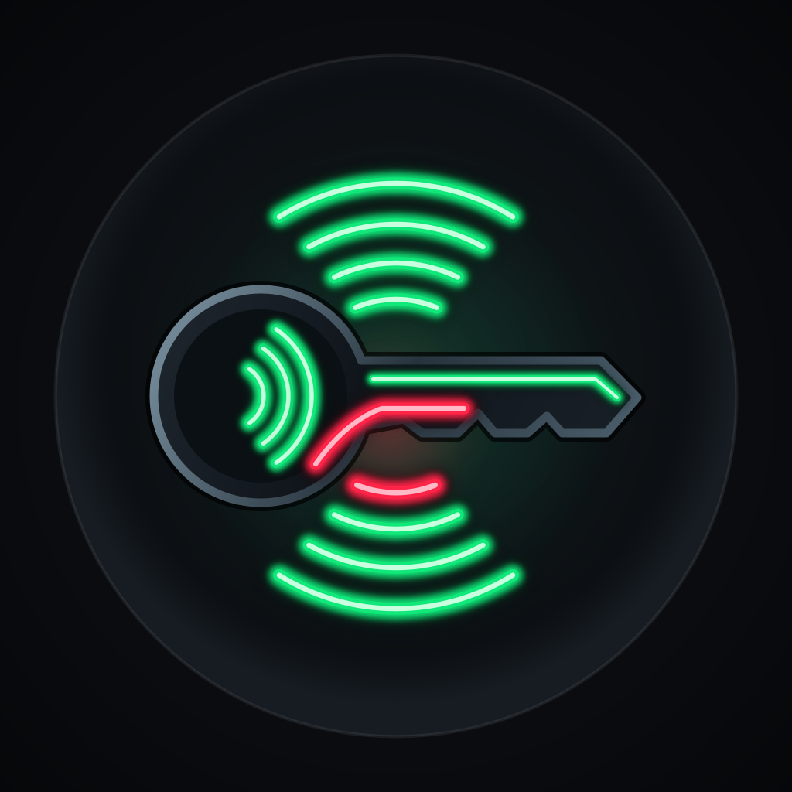
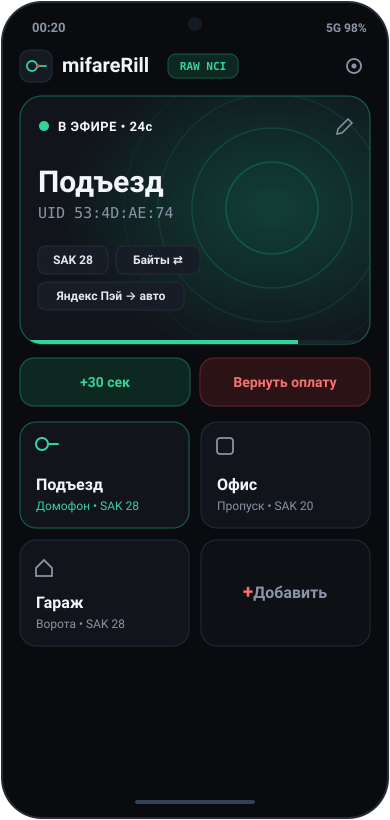
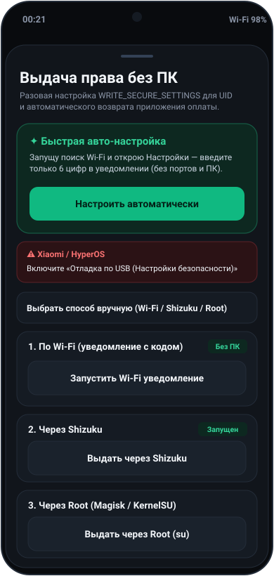
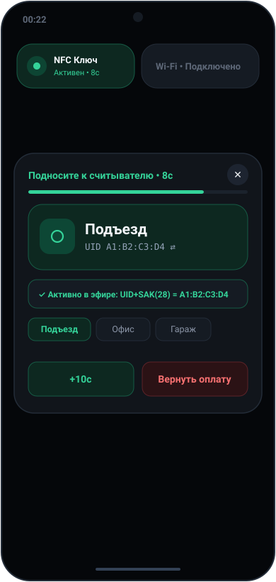

<p align="center">
  
</p>

<h1 align="center">mifareRill — NFC Ключница (v3.0.2)</h1>

<p align="center">
  Современное Android-приложение на <b>Kotlin + Jetpack Compose + Material 3</b> для хранения и эмуляции NFC-ключей (домофонов, пропусков, шлагбаумов и СКУД) с <b>реальной подменой аппаратного UID без root</b> на Android 15/16, <b>выдачей прав без ПК</b> и <b>автоматическим возвратом вашего приложения оплаты</b> (Яндекс Пэй, Т-Банк, Сбер, Mir Pay и др.).
</p>

<p align="center">
  <a href="releases/mifareRill-v3.0.2.apk"><b>⬇ Скачать mifareRill v3.0.2 (APK)</b></a>
</p>

> **Проверено на реальном оборудовании:** Xiaomi HyperOS (Android 16, API 36, без root) успешно открывает домофон **Beward (MIFARE)** на профилях `MIFARE+HCE (28)` и `HCE + UID (20)` с перевёрнутым порядком байт.

## Интерфейс v3.0.0 (Stealth Tactical)

<table>
  <tr>
    <td align="center"><br/><sub><b>Главный экран (Кокпит A3)</b></sub></td>
    <td align="center"><br/><sub><b>Выдача права без ПК</b></sub></td>
    <td align="center"><br/><sub><b>Плитка шторки (10с)</b></sub></td>
  </tr>
</table>

## Что нового в v3.0.0

- **Новый дизайн «Stealth Tactical» (OLED):** глубокий чёрный фон (`#090B0E`), изумрудно-зелёные и малиново-красные акценты, живой бейдж движка (`RAW NCI` / `OEM API` / `ROOT UID`) в шапке, объединённая карточка активного ключа с пульсирующим радаром, таймером `В ЭФИРЕ`, тонкой полосой прогресса и микро-чипами (`SAK`, `Байты ⇄`, `Яндекс Пэй → авто`), две симметричные кнопки `+30 сек` / `Вернуть оплату` и компактная 2-колоночная сетка ключей.
- **Новая адаптивная иконка «Кибер-ключ NFC»:** векторный силуэт ключа с неоново-зелёными NFC-волнами и алым ядром-акцентом.
- **Упрощённая выдача права без ПК (как в Shizuku):**
  - Одна умная кнопка **«Настроить автоматически»** — сама определяет запущенный Shizuku или Root, а если их нет, запускает встроенный фоновый сервис `WirelessAdbPairingService`.
  - **Wi-Fi ADB без разделённого экрана и без ввода портов:** приложение само находит порт по mDNS (`_adb-tls-pairing._tcp.` / `_adb-tls-connect._tcp.`) и показывает уведомление с полем `RemoteInput` — достаточно ввести только 6 цифр прямо в шторке.
  - Встроенная подсказка для **Xiaomi / HyperOS** и единые ровные кнопки (`48.dp`) во всех ручных способах.

## Основные возможности

- **Реальная эмуляция аппаратного ISO 14443-A UID (без root на Android 15/16)** — использует Raw NCI (`IDLE → CORE_SET_CONFIG [ATQA + SAK + LA_NFCID1] → resetDiscoveryTechnology → CORE_GET_CONFIG`) и `NfcOemExtension` через одноразовое право `WRITE_SECURE_SETTINGS` (плюс опциональный Root-бэкенд).
- **Плитка в шторке быстрых настроек + 10-секундное окно** — добавьте плитку **«NFC Ключ»** в шторку Android: по тапу всплывает компактная карточка поверх любого экрана, активирует ключ на 10 секунд, позволяет переключить ключ в 1 клик, а по таймеру сама закрывается и возвращает ваше приложение оплаты.
- **Авто-переключение и авто-возврат оплаты** — при запуске запоминает текущий системный кошелёк (включая Android 14–16 `RoleManager.ROLE_WALLET`), временно переключает NFC на `mifareRill`, а по фоновому таймеру (`AlarmManager` + `RestorePaymentReceiver`) возвращает прежний кошелёк обратно.
- **Переворот октетов (байт) для каждого ключа** — индивидуальный тумблер `⇄` (Little-Endian / Big-Endian, например `D4:C3:B2:A1 → A1:B2:C3:D4`).
- **Профили карты (`SAK` / `ATQA`)** — `MIFARE+HCE (28)` (по умолчанию для NXP/Xiaomi), `HCE + UID (20)`, `MIFARE 1K (08)`, `Ultralight (00)`.
- **Индивидуальное оформление и бэкап** — 16 иконок, 8 градиентов, экспорт и импорт базы ключей в **JSON**.
- **Встроенная диагностика NFC** — проверяет `NfcOemExtension`, `sendVendorNciMessage`, `registerNfcVendorNciCallback`, `Root` и показывает реальный ответ контроллера `CORE_GET_CONFIG`.

## Быстрая настройка (без ПК и без root)

Право `WRITE_SECURE_SETTINGS` требуется один раз (сохраняется после перезагрузки телефона). Откройте баннер на главном экране или **Настройки ⚙ → «Выдать право без ПК»** и нажмите **«Настроить автоматически»**:

1. **По Wi-Fi (Android 11+, без ПК и сторонних приложений):** откроются «Параметры разработчика» → включите *«Отладка по Wi-Fi» → «Подключить устройство по коду»* → введите 6 цифр прямо во всплывающем уведомлении `mifareRill` (порт подставится автоматически).
2. **Через [Shizuku](https://shizuku.rikka.app/) (в 1 нажатие):** если Shizuku запущен, право выдастся мгновенно.
3. **Через Root (Magisk / KernelSU):** мгновенная выдача через `su`.

*(На Xiaomi / HyperOS предварительно включите в «Для разработчиков» пункт **«Отладка по USB (Настройки безопасности)»**.)*

Классический вариант с компьютера (ADB):

```bash
adb shell pm grant com.nfckeywallet.app android.permission.WRITE_SECURE_SETTINGS
```

После выдачи права приложите физический ключ к телефону для добавления. Для домофонов **Beward / MIFARE** на Xiaomi используйте профиль **`MIFARE+HCE (28)`** или **`HCE + UID (20)`** и при необходимости включите **«Перевернуть октеты (байты)»**.

## Сборка из исходников

Требуется JDK 17+ и Android SDK 35:

```bash
./gradlew :app:assembleRelease
```

Готовый APK появится в `app/build/outputs/apk/release/app-release.apk`.

## Ограничения

- Эмуляция аппаратного UID воспроизводит именно **идентификатор карты (`NFCID1` + `SAK` + `ATQA`)** для домофонов и СКУД без криптографической проверки секторов. Зашифрованные сектора MIFARE Classic / DESFire и банковские карты не копируются.
- Поддержка Raw NCI / `NfcOemExtension` зависит от прошивки и NFC-чипа устройства (проверяется встроенной диагностикой в Настройках).

## Лицензия

[MIT License](LICENSE)

## Поддержать проект

Если приложение оказалось полезным, поддержать разработку можно переводом **USDT (сеть TON)**:

```text
UQCDxpB4BUPjxL-phj-ihrTiR5SLzKozvoKRSkp9ZMwgyJc3
```

[Открыть в TON-кошельке](ton://transfer/UQCDxpB4BUPjxL-phj-ihrTiR5SLzKozvoKRSkp9ZMwgyJc3)
