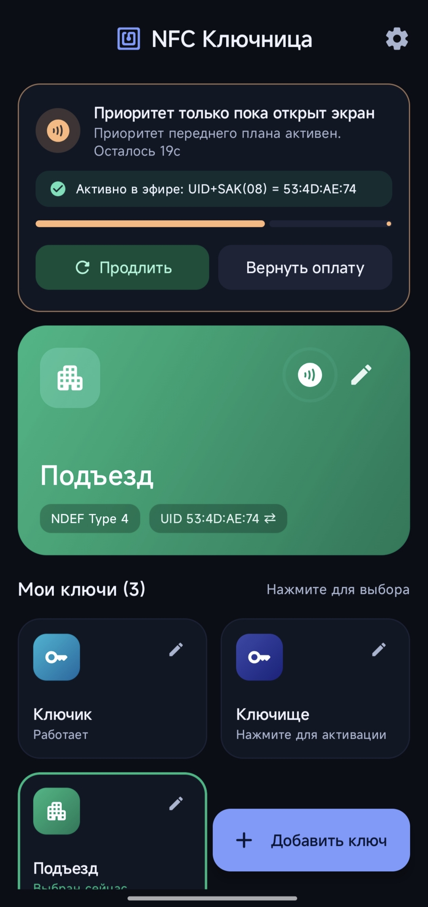
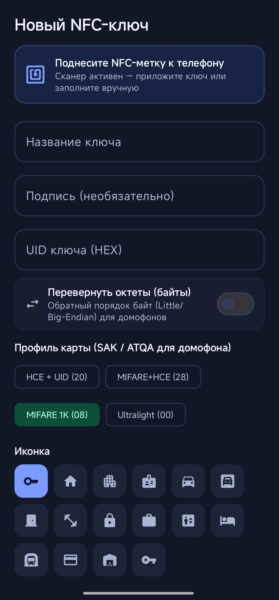
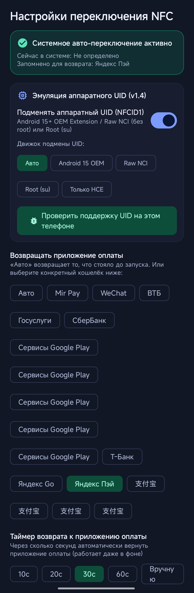

# mifareRill — NFC Ключница (Android)

Современное Android-приложение на **Kotlin + Jetpack Compose + Material 3** для хранения и эмуляции NFC-ключей (домофонов, пропусков, шлагбаумов и СКУД) с **реальной подменой аппаратного UID без root** на Android 15/16 и **автоматическим возвратом вашего приложения оплаты** (Яндекс Пэй, Т-Банк, Сбер, Mir Pay и др.).

> **Проверено на реальном оборудовании:** Xiaomi HyperOS (Android 16, API 36, без root) успешно открывает домофон **Beward (MIFARE)** на профилях `HCE + UID (20)` и `MIFARE+HCE (28)` с перевёрнутым порядком байт.

## Скриншоты

<table>
  <tr>
    <td align="center"><br/><sub><b>Главный экран</b></sub></td>
    <td align="center"><br/><sub><b>Добавление ключа</b></sub></td>
    <td align="center"><br/><sub><b>Настройки NFC</b></sub></td>
  </tr>
</table>

## Основные возможности

- **Реальная эмуляция аппаратного ISO 14443-A UID (без root на Android 15/16)** — использует Raw NCI (`IDLE → CORE_SET_CONFIG [ATQA + SAK + LA_NFCID1] → resetDiscoveryTechnology → CORE_GET_CONFIG`) и `NfcOemExtension` через одноразовое ADB-право `WRITE_SECURE_SETTINGS` (также есть опциональный Root-бэкенд).
- **Значок в шторке быстрых настроек + 10-секундное плавающее окно** — добавьте плитку **«NFC Ключ»** в шторку Android: по нажатию всплывает компактная карточка поверх любого экрана, активирует ключ на 10 секунд, позволяет переключить ключ в 1 тап, а по истечении таймера сама закрывается и возвращает ваше приложение оплаты.
- **Авто-переключение и авто-возврат приложения оплаты** — при запуске запоминает текущий системный кошелёк (включая Android 14–16 `RoleManager.ROLE_WALLET`), временно переключает NFC на «NFC Ключницу», а по фоновому таймеру (`AlarmManager` + `RestorePaymentReceiver`) возвращает прежний кошелёк обратно.
- **Переворот октетов (байт) для каждого ключа** — индивидуальный тумблер `⇄` (Little-Endian / Big-Endian, например `74:AE:4D:53 → 53:4D:AE:74`) для домофонов, которые читают UID в обратном порядке.
- **Профили карты (`SAK` / `ATQA`)** — `HCE + UID (20)`, `MIFARE+HCE (28)` (по умолчанию для совместимости с NXP/Xiaomi), `MIFARE 1K (08)`, `Ultralight (00)`.
- **Индивидуальное оформление и бэкап** — 16 иконок, 8 градиентов, название, подпись, а также экспорт и импорт базы ключей в **JSON**.
- **Встроенная диагностика NFC** — проверяет доступность `NfcOemExtension`, `sendVendorNciMessage`, `registerNfcVendorNciCallback`, `Root` и показывает реальный ответ контроллера `CORE_GET_CONFIG`.

## Быстрая настройка (без ПК и без root)

Право `WRITE_SECURE_SETTINGS` требуется один раз (сохраняется после перезагрузки телефона). В **v2.1.0** его можно выдать прямо внутри приложения (**Настройки ⚙ → «Выдать право без ПК»**) любым из 3 способов:

1. **По Wi-Fi (Android 11+, без ПК и сторонних программ):** включите *«Для разработчиков → Отладка по Wi-Fi → Подключить устройство по коду»*, введите 6-значный код и порт в окне приложения — `mifareRill` сам подключится к локальному `127.0.0.1` ADB и выдаст себе право.
2. **Через [Shizuku](https://shizuku.rikka.app/) (в 1 нажатие):** нажмите *«Выдать через Shizuku»* и подтвердите системный запрос.
3. **Через Root (Magisk / KernelSU):** нажмите *«Выдать через Root (su)»*.

*(На Xiaomi / HyperOS предварительно включите в «Для разработчиков» пункт **«Отладка по USB (Настройки безопасности)»**.)*

Или классическим способом с компьютера через ADB:

```bash
adb shell pm grant com.nfckeywallet.app android.permission.WRITE_SECURE_SETTINGS
```

4. Откройте **NFC Ключница → Настройки (⚙) → Проверить**.
5. Приложите физическую метку к телефону для добавления ключа. Для домофонов **Beward / MIFARE** на Xiaomi используйте профиль **`MIFARE+HCE (28)`** или **`HCE + UID (20)`** и при необходимости включите тумблер **«Перевернуть октеты (байты)»**.
6. Добавьте плитку **«NFC Ключ»** в шторку быстрых настроек Android для мгновенного открытия двери за 1 нажатие.

## Сборка из исходников

Требуется JDK 17 и Android SDK 35:

```bash
./gradlew assembleRelease
```

Готовый APK появится в `app/build/outputs/apk/release/app-release.apk`.

## Ограничения

- Эмуляция аппаратного UID воспроизводит именно **идентификатор карты (`NFCID1` + `SAK` + `ATQA`)** для домофонов и СКУД без криптографической проверки секторов. Зашифрованные сектора MIFARE Classic / DESFire и банковские карты не копируются.
- Поддержка Raw NCI / `NfcOemExtension` зависит от прошивки и NFC-чипа устройства (проверяется встроенной диагностикой в Настройках).

## Лицензия

[MIT License](LICENSE)
